<div align="center">


# mobileLLM

Chat with local and online models on iPhone and Mac.

[](LICENSE)
[](https://github.com/nanguoyu/mobileLLM/actions/workflows/ci.yml)

</div>

mobileLLM is a SwiftUI app for running models, using tools, and working with multiple agents.
Download a model for local chat, or connect an online service. Chats are stored on your device;
there is no mobileLLM account or telemetry.

<p align="center">
  <a href="assets/demo/chat.png">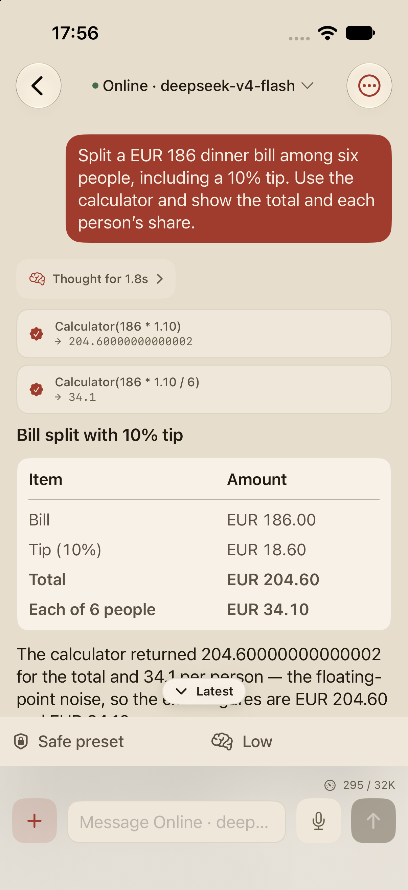</a>
  <a href="assets/demo/models.png">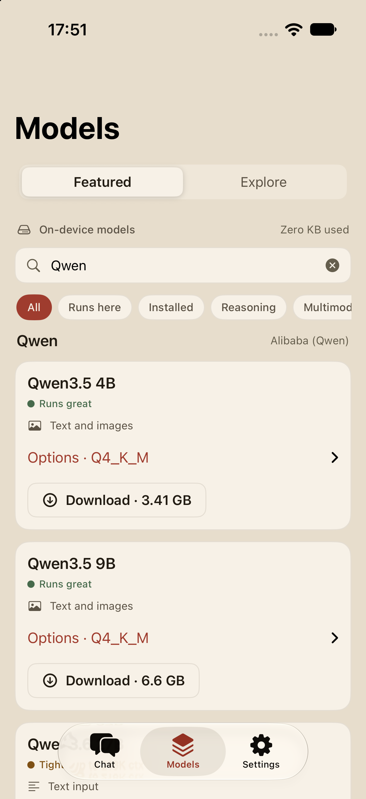</a>
  <a href="assets/demo/tools.png">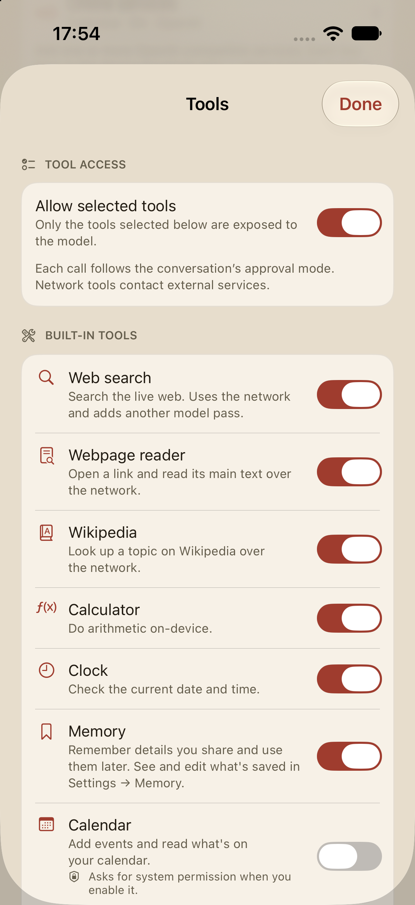</a>
</p>

<p align="center"><sub>Chat and tools · Model catalog · Tool permissions</sub></p>

## See it in use

<p align="center">
  <a href="assets/demo/models.png">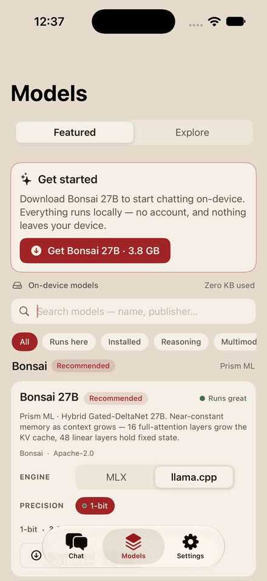</a>
  <a href="assets/demo/task-inputs.png">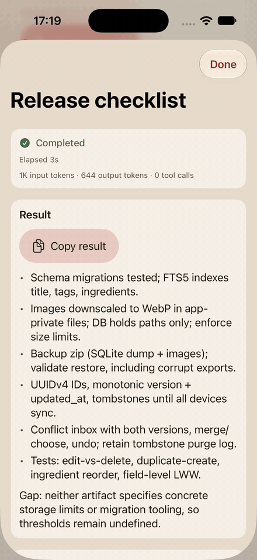</a>
</p>

Search the catalog to compare models before downloading. For a larger task, follow the agents as
they work: in this demo, two investigate storage and sync, and a third uses their findings to make
a release checklist. [Task workspace](assets/demo/workflow.png) · [Result and inputs](assets/demo/task-inputs.png)
· [Dark mode](assets/demo/workflow-dark.png).

Captured from the iPhone Simulator. Chat and workflow demos use the real DeepSeek `deepseek-v4-flash`
service. Both clips play at 2× speed; the workflow clip inspects saved results from an actual run.
[Capture details](assets/demo/README.md).

## Use it

**Local chat.** Open **Models**, choose a model and precision, and download it. The catalog shows the
download size and an estimated memory fit. Featured models include Bonsai, Qwen, Hunyuan, DeepSeek,
and Gemma; **Explore** searches Hugging Face for more.

| Model format | Runtime |
| --- | --- |
| MLX weights | MLX, including the pinned PrismML 1-bit fork |
| GGUF weights | llama.cpp; supported vision models also download a projector |
| Apple Intelligence | The system model on eligible devices, with no separate download |

**Online chat.** Open **Settings → Online models**, add a service URL, model ID, and API key, then
enable **Use online model**. Keys are stored in Keychain. The selected provider receives the
conversation context used for each request.

**Tools.** Open **Settings → Choose tools**, turn on tool access, and select what the model may use. Built-ins include
web search, webpage reading, Wikipedia, calculator, clock, memory, calendar, reminders, and location.
You can also connect MCP servers. Calendar, reminders, and location require system permission.
Choose **Ask**, **Safe preset**, or **Full access** in the conversation's approval control.

Web search works with public search engines by default. To use DeepSeek's paid Search and Fetch
APIs, select your configured DeepSeek account under **Choose tools → Web service**.

**Multi-agent work.** Choose **+ → Work with agents**, or start a message with `/workflow`,
and describe the goal and constraints.
The supervisor assigns work, passes results to dependent agents, and returns the final answer.
You can describe the goal without naming roles or stages. Independent tasks can run concurrently
at each dependency level. Declared reviews check current results; requested corrections return to the
affected agents and trigger fresh reviews within the same budget.
Open the workflow card to follow tasks and their source results, review requests, or pause and resume
work. Completed workflows remain available from the conversation menu.

Use **Update goal** to change a requirement while work is running. The change is saved, delivered to
active agents and carried into later tasks. The workspace shows dependencies, saved result versions
and the shared budget.

<p align="center">
  <a href="assets/demo/goal-result.jpg">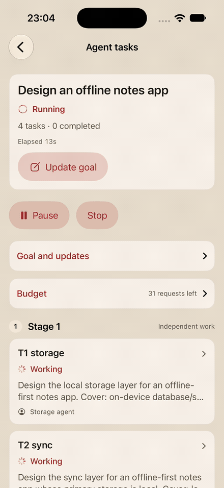</a>
  <a href="assets/demo/goal-result.jpg">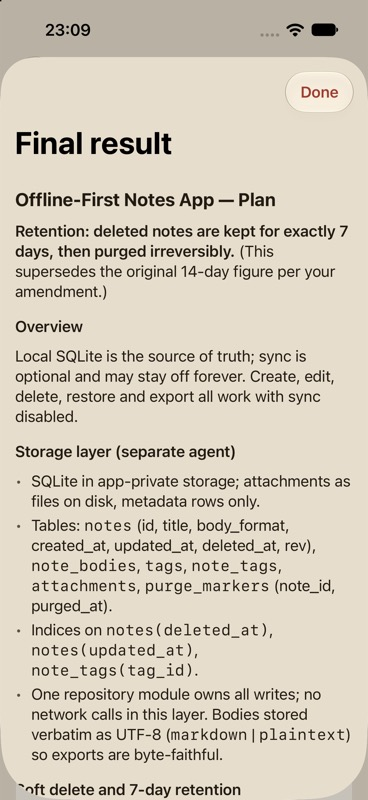</a>
</p>

This October 25 recording shows a human update during a real online run. The clip plays at 2× speed;
the final result is a separate screenshot. The run completed in 114 seconds.
[Original task, update and result](docs/evaluations/evidence/2026-10-25-live-goal-update.json).

The harness checks supported explicit output limits before accepting results. An oversized result
stays in history with its rejection reason while the agent corrects it. [Validated final plan](assets/demo/validated-plan.png)
· [Paused goal](assets/demo/goal-paused.png) · [Task results and limits](docs/evaluations/2026-10-26-agent-harness.md).

Task details also show acceptance criteria, the agent's assessment and recorded tool executions.
[Review and revision evidence](docs/evaluations/2026-10-26-acceptance-loops.md) includes both failures and
successful checks. Optional [OpenSandbox tools](docs/OPENSANDBOX.md) now provide real application
execution, browser checks and downloadable source. Without a configured execution environment,
an application request remains blocked instead of being marked complete with source text.

Connect OpenSandbox in Settings to give new tasks a project workspace, commands and browser checks.
Source archives and screenshots are saved with the task results.

<p align="center">
  <a href="assets/demo/opensandbox-settings.png">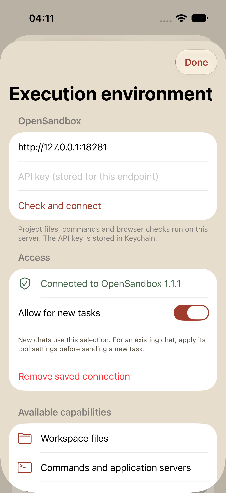</a>
</p>

<p align="center">
  <a href="assets/demo/goal-tasks.png">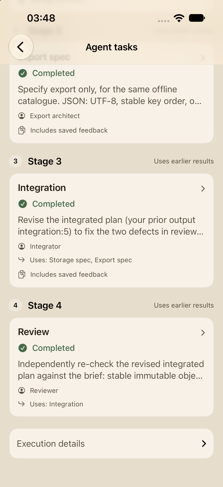</a>
  <a href="assets/demo/goal-rejected.png">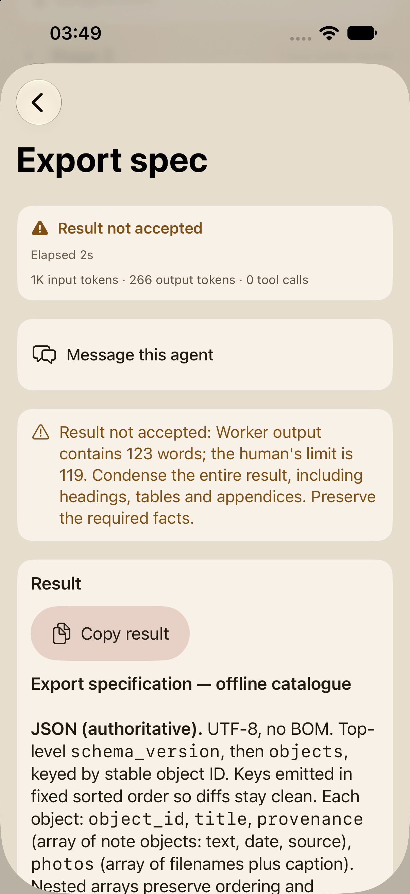</a>
</p>

Open a task and choose **Message this agent** to update it while it works, or continue its
conversation after the workflow finishes. The agent keeps its earlier context across app restarts.

<p align="center">
  <a href="assets/demo/agent-conversation.png">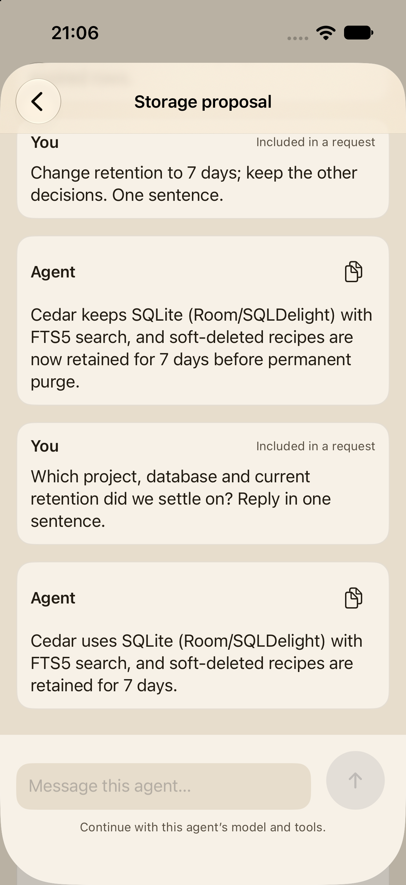</a>
</p>

The task shown in the demo was started with:

```text
/workflow Plan an offline recipe app. Have one agent propose local
storage, another examine sync conflicts, and a third use both results
to write a release checklist. Keep each worker under 80 words and the
final answer under 140 words. No web research.
```

You can also attach images to supported local vision models, dictate a message, use a reusable
`SKILL.md` instruction pack, and inspect or edit saved memories in Settings.

## Build from source

The app supports iOS 17+ and macOS 14+. Building requires Xcode with iOS 26 / macOS 26 SDKs or newer;
Apple Intelligence requires a supported device running iOS 26 / macOS 26 or later.
See [toolchain compatibility](docs/WIRING.md#toolchain-compatibility) for the pinned Swift and MLX dependencies.

```sh
brew install xcodegen cmake
./scripts/build-llama-xcframework.sh
cp Signing.xcconfig.example Signing.xcconfig
# Set your signing team in Signing.xcconfig when building for a device.
xcodegen generate
open mobileLLM.xcodeproj
```

Build the `mobileLLM` scheme in Xcode. The first llama.cpp framework build takes about 15–25 minutes.
An online model works in the Simulator; local GPU performance needs Apple hardware.
[CONTRIBUTING.md](CONTRIBUTING.md) covers setup and focused tests. For local API credentials, see
[developer configuration](SECURITY.md#developer-configuration-and-debug-artifacts).

## Privacy

Local inference, chat history, attachments, saved memories, and model weights stay on the device.
Online models receive the compiled conversation context, including enabled skills, relevant memories,
and tool results. Model downloads contact Hugging Face; web and MCP tools contact the selected
services. Dictation may use Apple's servers when on-device recognition is unavailable.
See [SECURITY.md](SECURITY.md) for credential storage and network permissions.

## Project status and documentation

Persistent agent conversations, team messaging, task dependencies and recovery after interruption
are implemented. Multi-stage workflows have completed real online-model tasks covering research,
planning, SQL migration and incident recovery.

Capability qualification is still open. An earlier six-family diagnostic passed 15 of 18 tasks;
later fixes have focused checks, but the current version has no complete six-family result yet.
Research coverage, semantic correctness, efficiency and a comparable DeepSeek Harness evaluation
remain unfinished. [Current status](docs/STATUS.md#remaining-harness-qualification) records the evidence
and next steps. Optional [OpenSandbox execution](docs/OPENSANDBOX.md) provides isolated project files,
commands, application servers, browser checks and source archives. Configure it explicitly in Settings.
The separate on-device iOS sandbox remains independent.

- [Architecture](docs/ARCHITECTURE.md): packages, model routing, tools, and agent execution.
- [Development guide](CONTRIBUTING.md): builds and validation for the behavior you change.
- [Issues](https://github.com/nanguoyu/mobileLLM/issues): bugs and feature requests.
- [Discussions](https://github.com/nanguoyu/mobileLLM/discussions): questions, ideas, and shared skills.

## License

[MIT](LICENSE). Downloaded models keep their own licenses, shown in the app.
