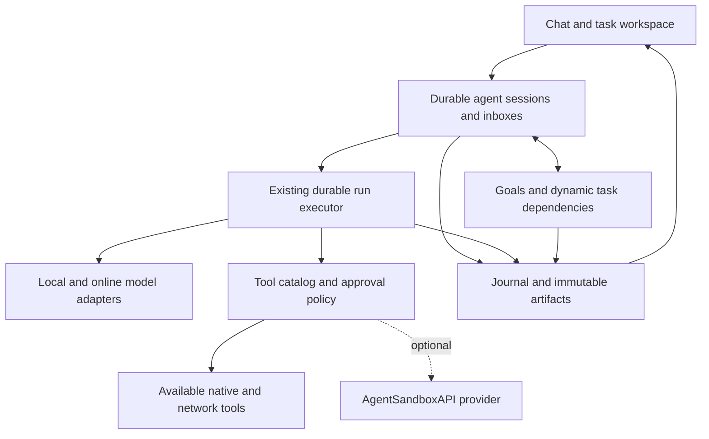

# Agent harness implementation plan

Date: 2026-10-24. Implementation baseline: `0c4578e` on `main`.

The next milestone is a general collaboration runtime that can keep working on a goal,
continue individual agents, exchange messages, revise dependencies, and recover after interruption.
DeepSeek Harness supplies the main architectural reference. OpenMinis supplies useful mobile
interaction and continuation examples. Quality will be assessed through actual task outcomes.

This is planned work. [STATUS.md](STATUS.md) records implemented behavior and observed results.
The owner's separate iOS agent sandbox is unavailable for near-term integration. The harness
milestone therefore has no dependency on that project's delivery.

## Sandbox boundary

An agent harness manages model requests, tools, context, work allocation, permissions, results,
and recovery. An agent sandbox supplies an isolated environment for operations such as executing
generated programs and manipulating a workspace. These responsibilities meet at an execution
provider interface. A missing provider restricts available actions without preventing collaboration.

The existing [sandbox contract](../spec.md#21-agent-sandbox-runtime-compatibility-seam) already
requires the application to work without a provider. Keep that boundary and the existing
`AgentSandboxAPI`. The ordinary iOS application sandbox and the JavaScriptCore orchestration realm
do not supply a general agent execution environment.

| Work | Near-term capability and acceptance |
| --- | --- |
| Persistent agents, messages, task dependencies, goal continuation, budgets and recovery | Implement and verify using the existing runtime. |
| Research, comparisons, planning, calculations and evidence analysis | Exercise real online models and currently enabled Search, Fetch, Calculator, Memory or configured tool adapters. Each case declares its actual tool set. |
| Producing code or a proposed SQL migration | Evaluate the generated artifact externally, as existing tests do. Record that execution belongs to the evaluator. |
| Running arbitrary generated code, installing packages, shell processes, or editing an execution workspace | Requires a suitable execution provider. Product execution and repair acceptance remains deferred. |
| Local model speed, thermal behavior and sustained iOS background execution | Separate hardware and OS measurements. These are not prerequisites for online-model collaboration tests on Simulator. |

Do not import the OpenMinis sandbox, build a substitute shell, or ship a fake execution provider.
Remote execution is an optional future adapter, not an assumed workaround or a new near-term
dependency. A test provider may verify contract behavior but never establishes product capability.
Unsupported tools remain absent from the model's catalog. A task requiring one records the missing
capability and any useful partial results. It does not invent successful execution.

## Design references and adoption decisions

Use pinned source and contracts to answer concrete implementation questions. Extend these references
only when a milestone exposes an unresolved design problem.

| Reference | Adopt in mobileLLM | Boundary |
| --- | --- | --- |
| DSH [subagent manager](https://github.com/deepseek-ai/deepseek-harness/blob/22ddee3792402c3e70ec5f86a63c3e3e895a2f60/packages/subagent/subagent/src/manager.ts) and [inbox](https://github.com/deepseek-ai/deepseek-harness/blob/22ddee3792402c3e70ec5f86a63c3e3e895a2f60/packages/core/agent-loop/src/inbox.ts) | Separate a durable child conversation from its current execution. Admit queued and steering messages at defined boundaries. | Keep the existing Swift executor, journal, authority and model adapters. Specify acknowledgement durability explicitly. |
| DSH [task board](https://github.com/deepseek-ai/deepseek-harness/blob/22ddee3792402c3e70ec5f86a63c3e3e895a2f60/packages/experimental/agent-team/src/task-board.ts) | Versioned task ownership, dependencies, claim, release, reassignment and reopening. | Its write-scope hints are advisory. They do not replace our authority checks or future workspace isolation. |
| DSH [goal driver](https://github.com/deepseek-ai/deepseek-harness/blob/22ddee3792402c3e70ec5f86a63c3e3e895a2f60/packages/goal/goal-round-driver/src/index.ts) | Persist the objective separately from one model turn. Continue only when work and budget permit it. | Keep bounded progress and user controls. A model's completion assertion is not independent evidence of correctness. |
| DSH [compaction](https://github.com/deepseek-ai/deepseek-harness/blob/22ddee3792402c3e70ec5f86a63c3e3e895a2f60/docs/subsystems/compaction.md) and [skills](https://github.com/deepseek-ai/deepseek-harness/blob/22ddee3792402c3e70ec5f86a63c3e3e895a2f60/docs/subsystems/skills.md) | Recoverable context reduction, preserved tool pairs, original-result references and skill loading on demand. | Summaries remain fallible derived context. Preserve original instructions, evidence and artifacts. |
| DSH [capability composition](https://github.com/deepseek-ai/deepseek-harness/blob/22ddee3792402c3e70ec5f86a63c3e3e895a2f60/docs/architecture.md) | Separate capability contracts, providers and model-facing tools. Share the production path with evaluation. | Extend existing Swift packages. A general plugin marketplace and hot-reload framework are outside this milestone. |
| OpenMinis [helper controls](https://github.com/OpenMinis/OpenMinis/blob/b4c0661d5631ebab4d1a2e6f3fd4c805d4030a6c/src/ios/Agent/Jobs/HelperRunner.swift) | Clear child steering, resumption and mobile status presentation. | Retain durable message admission rather than its in-memory pending-steer queue. Its sandbox is not adopted. |

DSH's [published limitations](https://github.com/deepseek-ai/deepseek-harness/blob/22ddee3792402c3e70ec5f86a63c3e3e895a2f60/packages/subagent/subagent/README.md#known-limitations-and-deferred-work)
include process-local ownership and message-loss windows. Agent Teams is experimental. These
references establish useful mechanisms, not a guarantee of task correctness or distributed delivery.

## Runtime structure

Keep one production execution path. A durable session coordinates successive runs through
`DurableAgentExecutor`; it does not implement another model or tool loop. Ordinary chat,
delegated work, and goal continuation use the same execution and recording primitives.

A **session** owns an agent's identity, history and pending messages. An **activation** is its
current admitted execution. A **task** describes an assigned outcome and its dependencies.
Several activations can contribute to one task, and an agent can work on successive tasks.
Their identities must remain distinct. Finishing an activation does not automatically complete
its task or the user's goal.

The session history references immutable run events and artifacts rather than copying an entire
transcript into every child. A new activation receives a reproducible context manifest. Steering
an active run creates an accepted input event and a new step context at a safe boundary; it does
not mutate an already submitted model request or its frozen authority.

The root conversation provides the coordination agent. Delegation, messaging, waiting and task
updates are narrow tools using the existing tool pipeline. Simple requests can finish directly.
Explicit requests for collaboration and dependent stages must be fulfilled through actual agents
and handoffs. Writer and reviewer roles are created only when they contribute necessary work.

## Delivery sequence

Each stage includes its relevant checks and a usable product path. Later stages do not defer
correctness checks for earlier ones. Deliver small behavior changes directly to `main`, with a
commit and push before reporting them. Update the corresponding specification and its existing
verification bindings when implementation changes the contract.

### Stage 1 Persistent sessions and message admission

Extend `AgentContracts`, `RuntimeRepository`, `SQLiteRunJournal`, `AgentRunController` and
`SubagentSpawner`. Introduce session identity and an explicit link to existing run IDs. Reuse
command identifiers, version checks and the durable executor rather than creating a second inbox
inside the UI or orchestration script.

Implement two input modes: queued messages start a subsequent turn, while steering messages are
eligible at the next model-step boundary. Accepted messages retain sender, target, content digest,
sequence and disposition. Commit acceptance before acknowledging it. Claiming input and recording
the request that consumes it must be recoverable as one logical transition, so a crash between
those operations cannot discard an instruction. Duplicate command submissions reuse the same
receipt. Local durable consumption does not imply exactly-once external side effects.

Parent-to-child and child-to-parent delivery come first. Reuse one addressed inbox mechanism when
Stage 2 adds authorized peer delivery. A stopped or completed run remains immutable; further work
creates a new activation in the same session. Only one activation may own a session at a time.

Acceptance: continue the same child across three turns, steer it while a tool is in flight, and
restore accepted pending input after process recreation. Verify duplicate delivery, late input,
sender authorization, cancellation and the acceptance-to-consumption crash boundary. One focused
Simulator interaction must show the pending instruction and resulting child response without
overwriting the root conversation.

### Stage 2 Event-driven collaboration and task dependencies

Extend the workflow journal and reuse `WorkflowDispatchScheduler` and `WorkflowBudgetCoordinator`.
Add versioned task state, ownership, dependency edges and immutable input/output references.
Reject cycles, stale updates, unavailable inputs and unauthorized claims. Record partial results
and failed attempts separately from task completion. Reopening an upstream task must explicitly
invalidate or request review of affected downstream work, without changing its historical inputs.

Dispatch ready work as capacity becomes available. A finished source task can unblock its consumer
while an unrelated sibling is still running. Log admission order and chosen artifact versions so
recovery preserves the recorded decision rather than deriving a different order from current timing.
Pause prevents new dispatch, stop drains owned work, and unresolved effects continue to require
reconciliation. Waiting parents do not hold worker permits. Queue pressure and budget exhaustion
remain visible; neither silently discards work.

Provide scoped delegation, send, wait and task operations through the ordinary runtime. Peer messages
require membership in the same authorized team and record the actual sender. Local model work
continues through the residency arbiter; online work overlaps only within its admitted limits.

Acceptance: start a dependent task before an unrelated slow sibling ends, recover a failed worker
without losing successful siblings, reject competing task claims, and preserve exact source bytes
through reassignment and recovery. Test ordering deterministically at the runtime boundary, then
use a real model case to measure whether its delegation decisions produce the requested result.

### Stage 3 Goals and bounded continuation

Add a durable goal controller over the same session and task APIs. Record the original objective,
user amendments, completion conditions, unresolved items, goal revision and cumulative budget.
Distinguish active, paused, blocked, budget-exhausted, cancelled and completed outcomes. A model
cannot rewrite the user's completion conditions merely to make delivery easier.

Continue when useful work remains and the controller has authority and budget. Prefer admitted
messages and actual child results over synthetic continuation rounds. Wait for relevant active
work instead of spending model calls polling it. Detect repeated actions and lack of new evidence
without requiring a permanently fixed sequence of planner, writer and reviewer agents.

A final answer request must account for required tasks, accepted pending input, unresolved effects
and applicable completion checks. The model's judgement is recorded as such. Exact numeric or
structural conditions use executable checks where available; open research coverage remains an
independently evaluated outcome. A budget limit records the remaining work and partial output.

Acceptance: continue after an incomplete turn, incorporate an explicit user amendment, stop at the
budget boundary, and resume without repeating already settled effects. A terminal-looking response
must not hide an unfinished required task. Ordinary app launch must not silently restart work.

### Stage 4 Long context and capability composition

Extend `ContextCompiler` and the existing artifact store. Keep user requirements, task state and
pending decisions in context, retain recent working material, and replace large older material
with references that can be read without another agent. Preserve tool-call/result pairing and
record all context selections. Add optional summary compaction only after deterministic pruning
and artifact reads are insufficient. Persist the summary inputs, output, model usage and commit
boundary so failure preserves the previous usable context.

Extend the existing skill and tool selection paths with bounded discovery and on-demand skill
loading. A per-agent profile selects model policy, reasoning effort, permitted tools and skills
inside the user's ceiling. Keep explicit skill selection for small local models. Capability changes
are applied at defined admission boundaries; old requests retain their frozen catalog, grants and
provider identity. Provider disappearance yields an explicit unavailable state.

Acceptance: retain an early requirement and a later correction after context reduction, recover a
failed compaction, preserve source attribution, and prevent disabled tools or skills from appearing
in new requests. Measure context bytes, tokens and repeated reads on long cases. Prompt changes
alone cannot count as a completed capability.

### Stage 5 Mobile interaction and recovery qualification

Extend the existing task workspace and observer stores instead of adding another dashboard.
Expose pending and consumed messages, assignment changes, dependency blockers, partial outputs,
goal progress and remaining budget. Display runtime-derived facts, with details available on demand.
Observing or closing a view must not create, resume or cancel execution.

Preserve current lifecycle rules: an eligible granted background task may continue, otherwise work
quiesces and reports its actual state. App suspension and process death do not imply success.
Reconnect by durable identity and cursor, reattach before considering a new submission, and retain
uncertain effects for reconciliation. Pending approvals and user questions survive restoration.

Acceptance uses the actual Simulator app and online transport for steering, approvals, task result
navigation, interruption and relaunch. Use deterministic transport only for controlled UI states,
and label that evidence separately. Physical-device background scheduling and local inference
performance remain separate measurements.

## Migration and removal of redundant paths

New orchestration receives an explicit version at launch. Existing workflow scripts, snapshots,
prefix identities and saved artifacts retain their original semantics. Do not reinterpret an old
record as a new task graph or recompute its outputs. Historical display metadata must not invent
messages, instructions or task states that were never recorded.

Move new launches to the session-based path after its focused acceptance gates pass. The current
`CoordinatedWorkflow` program and archived `WorkflowOrchestrator` then remain reachable only where
their persisted versions require them. Reuse the same executor, tool adapters, approval policy,
budget accounting and storage. Do not keep a second planner or special evaluator orchestration
as an alternative production path. Remove transitional launch switches after cutover; retain
versioned readers and replay code only while records depend on them.

## Evaluation without an execution sandbox

Extend `AutonomousWorkflowLiveTests` and its production assembly entry point as the launch path
evolves. Keep task prompts and outcome oracles outside runtime code. Existing accepted evidence
remains tied to its tested revision. Retain failures, incomplete answers and capability refusals.
An unattended pass receives only its original task, with no maintainer corrections or transferred
intermediate answers. Scripted user amendments belong only to explicitly interactive cases.

Use six task families with a development case and a held-out variant each:

| Family | Independent outcome check |
| --- | --- |
| Source-based research and comparison | Required coverage, actual retrieved support, conflicting evidence and correct attribution; record the search window. |
| Constrained planning and replanning | Feasibility, dependencies, optimum where computable, changed requirements and actual Calculator use. |
| Incident analysis | Correct separation of observations, hypotheses and uncertain external effects. |
| Dependent artifact construction | Exact input handoff and semantic artifact checks, including original middle or tail sections. External code execution stays explicitly attributed to the evaluator. |
| Iterative collaboration | A scripted user amendment reaches the intended agent, changes the result, and preserves unrelated requirements. This is an interaction test, not an unattended one-input result. |
| Long-context synthesis | Required early facts, later corrections, provenance and successful reads of material omitted from the current context. |

Runtime fault cases separately cover message races, stale ownership, denied capabilities,
cancelled tools, replay and compaction interruption. Controlled failures exercise real storage and
execution control with a deterministic external boundary. They do not establish real-model success.

For each behavior change, run the affected existing tests and the smallest task that measures the
changed behavior. Reuse saved traces and external artifact checks when the model answer is unchanged.
Documentation-only edits need link and diff checks, not app builds, full suites or live inference.

At a capability milestone, freeze the build, model settings, prompts, oracles and budgets before
running held-out tasks. Start with three runs of one held-out variant in each family, eighteen
runs per harness. This is an initial diagnostic sample, not proof of a general success rate.
Report every attempt and uncertainty; expand only to resolve a specific reliability question.
An evaluator correction is disclosed and applied to retained outputs wherever possible.

Compare with a pinned DSH build using the same model and genuinely common tools. Keep inputs,
budgets and completion checks identical. Live web tasks run in a comparable time window and report
source drift; differing tool semantics are separate conditions. Run DSH comparisons only at a
defined capability checkpoint, not after routine commits. Record independent completion, manual
intervention, unsupported or invented execution, failures, model/tool calls, tokens and elapsed
time. App navigation and human waiting are separate from execution time. Results from different
revisions do not form a single success-rate estimate.

The near-term milestone requires all deterministic lifecycle and authority cases to pass, successful
independent outcomes across the six families, and repeated-run evidence that identifies remaining
failures. A DSH-level outcome claim requires the comparable task results to support it. Coding,
terminal and arbitrary workspace parity cannot be claimed from this sandbox-free qualification.

## Integrating the separate sandbox later

Retain the existing `AgentSandboxProvider` contract: versioned capabilities, idempotent `start`,
opaque handles, `attach`, cursor-based events, status, result and explicit commands. The registered
provider policy, immutable authority and resource budget remain authoritative. Ending observation
only detaches. Result delivery retains artifact identities and uncertain-effect information.

Do not freeze the private project's transport, process model, filesystem mounts, checkpoint
format or distribution now. Negotiate only capabilities the real provider supports. Workspace
reuse and process checkpointing are independent capabilities; unavailable ones are never inferred
from the existence of a handle or saved transcript.

The later integration adds a provider and adapters to existing Tool V2 execution. It must not
require rewriting sessions, task scheduling, goal continuation or the task UI. Only then add
production code-edit/run/fix, data processing, document generation and workspace-conflict cases.
Validate actual artifacts and confinement with that provider. Existing sandbox contract fakes
remain contract evidence only.

## First implementation slice

Start Stage 1 with one child session, durable input admission and repeated activation through the
existing executor. Deliver a single real interaction: delegate a task, append a requirement while
it runs, inspect its result, relaunch, and continue the same child with its recorded context.
Prove acceptance and recovery boundaries before expanding to a task board. This first slice
delivers a missing collaboration capability without waiting for or replacing the sandbox project.
