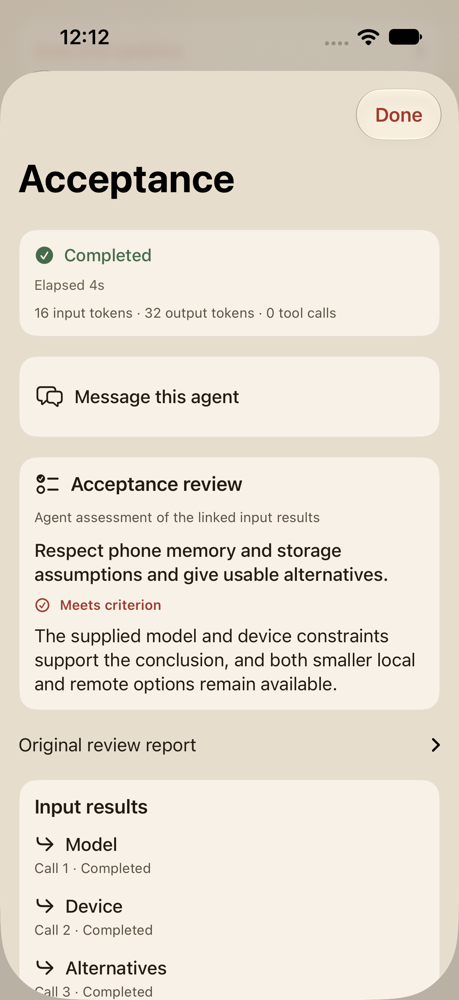

# Task acceptance and delivery capabilities

The collaboration runtime now records review criteria, binds reviews to exact artifact versions,
and returns failed criteria to the affected producers. A short goal can initiate planning in
**Work with agents** without specifying roles or stages. Ordinary chat still has a separate entry
path. The runtime supports concurrent agents at every dependency level, with at most four active
workers in the current collaboration program.

## What changed

A required review identifies its producer tasks, criteria and any tools whose execution is necessary.
Its agent must differ from the producers. The host records each criterion's assessment against the
actual input versions. A `revise` result reopens only affected producers, supplies the original output
and feedback, and invalidates dependent reviews. Unaffected branches keep their accepted work. Two
automatic corrections per producer and human-amendment revision share the existing goal budget.
Missing capabilities and exhausted corrections remain unresolved. A human amendment invalidates older
acceptance. Passing reviews must cover current required outputs before final delivery.

The review is a model assessment. Required tool receipts come separately from successful executor
journal records, including local tools such as Calculator. A model's statement that it ran a test
cannot supply a receipt. Recorded execution by itself does not establish semantic correctness.

Preparation also declares the requested outcome: information, explicitly requested source text,
a saved artifact, a running application or a published service. The app freezes this declaration
with the capabilities available from its registered environment. Unsupported delivery is blocked
before worker dispatch and checked again at publication. The current app has no production workspace
or execution provider. The requested outcome is inferred by the model and remains an evaluation target.

## Real tasks and retained failures

The production Simulator assembly used the requested `deepseek-v4-flash` alias at low effort.
The reservation prompt supplied table sizes, booking intervals, allocation rules and a JSON format;
it did not prescribe agent identities or stages. A separate Swift oracle checked allocation order,
smallest suitable tables, overlapping intervals, closing time and deposits. Counterexamples checked
that the oracle rejects double booking, after-hours acceptance and incorrect totals.

The second prompt was exactly: “开发一个中餐馆网站，支持在线订台。” It tested whether the app preserved
the requested implementation outcome when execution capabilities were absent.

| Task | Revision | Observed outcome |
| --- | --- | --- |
| Reservation allocation | `5eba522` | Paused after 92.6 seconds. Calculator ran, but receipt collection filtered out local operations, so the required review could not pass. |
| Restaurant website | `5eba522` | Incorrectly completed after 216.2 seconds with HTML and browser-local storage. Static source review had substituted for delivery of a working online service. |
| Reservation allocation | `a856182` | Completed in 73.6 seconds. Two persistent worker identities produced and reviewed the result; four criteria passed, and the review retained two actual Calculator receipts. The independent outcome checks passed. |
| Restaurant website | `a856182` | Blocked in 38.9 seconds after preparation, before any worker dispatch. The recorded reason names missing workspace access, code execution and application testing. No website was delivered. |

[All four attempt records](evidence/2026-10-26-task-acceptance.json) retain the original outcomes.
The later blocker passes the capability-boundary check; it is not a successful website implementation.
The successful reservation run used six child/coordinator activations and recorded 118,660 input and
9,864 output tokens. It included a repeated worker activation for pending input. Efficiency remains
open; these runs are not a controlled performance comparison.

The first batch also exposed an evaluator mismatch: it compared structured review JSON with model
transport text rather than the canonical artifact actually passed downstream. The evaluator now reads
the committed artifact through the app's result reader. Original failures remain in the evidence.

## Runtime and interface checks

A controlled test through the production engine executes two producers concurrently, then two reviews
concurrently. One review requests a correction. Only that producer and its reviewer execute again,
while the other accepted branch remains unchanged. Exact call counts and preserved feedback inputs
are checked. Separate cases cover missing tool receipts, stale reviews after amendments, correction
limits, and attempts to bypass delivery capability checks. This proves execution control with a
controlled subagent boundary; it is separate from the real task outcomes above.

The focused runtime and graph regressions passed. Initial integration found an optional-schema null
handling error; its repair passed all 38 selected runtime cases. Later targeted checks covered the
amendment and capability additions. The local-tool receipt regression runs through the real executor
and verifies the settled invocation identity and record digest. The specification verifier passed.

The Simulator UI scenario passed at `bbf6401`: approvals, four task results, acceptance criteria,
three exact producer links, agent follow-up, copying, five recorded workflow calls, source inspection
and final projection into chat. The earlier UI attempt passed the new acceptance assertions but failed
an outdated `V5` source-marker assertion. The corrected assertion checks the current `V6` marker.

This screenshot uses the isolated UI fixture, not an online model response. It shows interface behavior;
the real model records are linked above. No unrelated full suite or six-family matrix was rerun.

## Work still open

The code supports a bounded review and revision loop using available tools. An actual application
build, browser test, repair and retest loop still needs a production execution provider. No substitute
sandbox was added. Reviews and requested-outcome classification remain fallible model decisions.
Current-version six-family qualification, broader research coverage, efficiency and a matched DeepSeek
Harness comparison remain open in [the implementation plan](../AGENT_HARNESS_PLAN.md#remaining-capability-qualification).
The earlier 15/18 diagnostic remains tied to its original revision.
