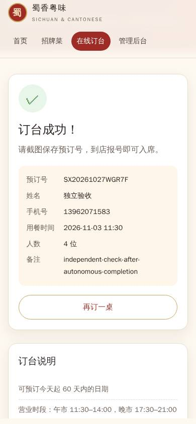

# OpenSandbox development validation

mobileLLM completed three kinds of work through its production coordinator, durable workers,
Tool V2 authorization and real OpenSandbox containers. The application planned and executed each
task from its original prompt. No external agent supplied an implementation or corrective prompt
during a run. Independent outcome checks ran after the application finished.

| Task | Completed run | Workers / recorded tools | Independent outcome |
| --- | --- | --- | --- |
| Repair an existing inventory function | 78.6 s; b92502a; Flash low, 32K context | 2 / 11 | Aggregated requests, invalid quantities, atomic rejection and unchanged inputs passed; original tests remained byte-identical. |
| Build a reproducible sales analysis | 96.9 s; b92502a; Flash low, 32K context | 2 / 12 | Original totals were exact. The exported program also passed a replay on unseen shuffled orders, including a later cancellation. |
| “开发一个中餐馆网站，支持在线订台。” | 298.0 s; 4691f51; Flash high, 128K context | 2 / 21 | Mobile browser booking returned a real confirmation code. A fresh client and a service restart retained the record. Duplicate and six invalid requests were rejected without changing capacity. |

The configured model alias was deepseek-v4-flash on the official service. Budgets and reasoning
settings differ between these development runs. They are not a frozen reliability benchmark.
[The complete attempt ledger](evidence/2026-10-27-opensandbox/evaluation-ledger.json) retains earlier
blocked, interrupted and failed runs, their limits, task relationships and native receipt digests.
[Original failed worker reports and available source archives](evidence/2026-10-27-opensandbox/original-failures.json)
are retained separately from accepted outcomes.

## What the failures changed

Real execution exposed issues that compilation and protocol fakes had missed: invalid filesystem
requirements, lost failure diagnostics, known failures incorrectly requiring human reconciliation,
truncated screenshot data in command logs, stale service handles, and startup checks accidentally
accepting an old server's response. Those paths now have targeted real-container regressions.

Failed browser checks retain page text, control visibility, script output and screenshots. Standard
Playwright regex and date helpers work directly. Service discovery returns actual managed handles;
startup rejects occupied ports and verifies the new process, and stop waits for confirmed exit.
Stateful retries after intervening workspace work are permitted while immediate identical loops
remain bounded. Failure output reaches the next edit without converting the failure into success.

New execution-enabled goals freeze 48 tool calls and 64 model requests, with up to 12 tool calls
per activation. Other goals and older saved graphs retain their existing limits. Reviews cannot
require tools excluded by their own profiles or exceed their activation allowance. Successful
current-source evidence can be reused across reviewers. This removes mandatory duplicate browser
checks and exports while retaining independent acceptance.

The website run used a 131,072-token context and a 65,536-token per-attempt output ceiling.
Earlier high-effort runs with a 24K output cap sometimes exhausted reasoning before returning an
action. The runtime now respects the configured context and declared service output limit.
DeepSeek recommends high effort for agent work in its
[official release notes](https://api-docs.deepseek.com/news/news260813/).

## Evidence and scope

- [Website source](evidence/2026-10-27-opensandbox/restaurant-source.zip),
  [application result](evidence/2026-10-27-opensandbox/restaurant-result.json), and
  [independent browser/restart checks](evidence/2026-10-27-opensandbox/independent-website-checks.json).
- [Inventory source](evidence/2026-10-27-opensandbox/repair-source.zip) and
  [original-test preservation](evidence/2026-10-27-opensandbox/independent-repair-inputs.json).
- [Sales source](evidence/2026-10-27-opensandbox/sales-source.zip) and
  [unseen-input replay](evidence/2026-10-27-opensandbox/independent-sales-replay.json).

The website is a local demonstration. Its generated README explicitly requires an admin token
and HTTPS before deployment; public hosting, messaging and payments were not part of this test.
These examples establish working execution and collaboration paths, not universal task reliability
or DeepSeek Harness parity. The earlier six-family 15/18 sample retains its own version and outcome.

Native provider tests cover recovery without duplicate execution, cancellation, service collisions,
large artifacts, confined paths and failed-page observations. A separate fixed-action regression
uses the real authorization and container path to verify failed test → edit → identical retest,
including runtime-data changes. It is a mechanism test, not an autonomous model score.
Simulator interaction verified connection, reconnect, access toggles, removal and relaunch.

Setup, resource limits and ownership-based teardown are described in [OPENSANDBOX.md](../OPENSANDBOX.md).
The cleanup record is added after teardown has been verified.
